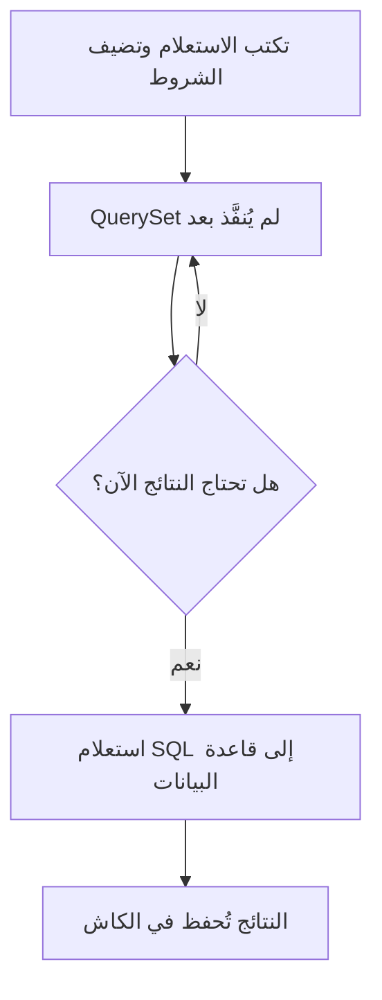

import { Aside, FileTree, Tabs, TabItem } from '@astrojs/starlight/components';
import { Exercise, Hint, Solution, Quiz, Summary, Term, Figure } from '~/components/study';
import QuerySetCache from '~/assets/diagrams/queryset-cache.svg';

<Aside type="note" title="صفحة نموذجية">
	هذه الصفحة تعرض شكل الدرس وأدواته. محتواها مأخوذ من وثائق Django 6.1، لكنها ليست الدرس 2.1 النهائي.
</Aside>

## الفكرة في سطر

الـ <Term def="كائن يمثّل استعلاماً على قاعدة البيانات، ولا يُنفَّذ حتى نحتاج نتيجته">QuerySet</Term> كسول: تبنيه وتضيف عليه الشروط كما تشاء، ولا يرسل Django أي استعلام إلى قاعدة البيانات حتى تحتاج النتائج فعلاً.



## مثال من منصة الوظائف

لاحظ أن السطرين 1 و2 لا يرسلان أي استعلام. الاستعلام يُنفَّذ مرة واحدة فقط في السطر 4، عندما تبدأ الحلقة:

```python title="python manage.py shell" showLineNumbers {4}
jobs = Job.objects.filter(is_open=True)  # لا استعلام بعد
jobs = jobs.order_by("title")  # ولا هنا

for job in jobs:  # هنا يُنفَّذ الاستعلام
    print(job.title)
```

هذه الملفات التي نعمل عليها في تطبيق `jobs`:

<FileTree>
- config/
  - settings.py
  - urls.py
- jobs/
  - **models.py** فيه الـ model المسمّى Job
  - views.py
  - admin.py
- manage.py
</FileTree>

## متى يُنفَّذ الـ QuerySet؟

| العملية | هل تنفّذ الاستعلام؟ |
| --- | --- |
| `filter()` و`exclude()` و`order_by()` | لا، ترجع QuerySet جديداً |
| التقطيع `jobs[:5]` | لا، ما لم تستخدم الخطوة مثل `jobs[::2]` |
| الحلقة `for job in jobs` | نعم |
| `len(jobs)` و`list(jobs)` | نعم |
| `if jobs:` أو `bool(jobs)` | نعم |
| `repr(jobs)`، أي طباعته في الـ shell | نعم |

<Aside type="tip">
	إذا أردت العدد فقط، استخدم `jobs.count()` بدل `len(jobs)`: يحسب العدد في قاعدة البيانات بدل جلب كل الصفوف.
</Aside>

## الكاش: لماذا تحفظ الـ QuerySet في متغير

أول مرة يُنفَّذ فيها الـ QuerySet، يحفظ Django النتائج في كاش داخله. أي استخدام بعدها لنفس الـ QuerySet يقرأ من الكاش، بلا استعلام جديد.

<Figure caption="كتابة Job.objects.all() مرتين تنشئ QuerySet جديداً كل مرة، بينما المتغير يحتفظ بالكاش">
	<QuerySetCache />
</Figure>

<Tabs>
	<TabItem label="الصحيح">
		```python
		jobs = Job.objects.all()
		print([job.title for job in jobs])  # استعلام
		print([job.company for job in jobs])  # من الكاش
		```
	</TabItem>
	<TabItem label="الخطأ">
		```python
		print([job.title for job in Job.objects.all()])  # استعلام
		print([job.company for job in Job.objects.all()])  # استعلام آخر
		```
	</TabItem>
</Tabs>

ونفس التحسين بصيغة «قبل وبعد»:

```python del={1-2} ins={3-5}
print([job.title for job in Job.objects.all()])
print([job.company for job in Job.objects.all()])
jobs = Job.objects.all()
print([job.title for job in jobs])
print([job.company for job in jobs])
```

<Aside type="caution" title="خطأ شائع">
	التقطيع أو الفهرسة على QuerySet لم يُنفَّذ لا تملأ الكاش. كتابة `jobs[5]` مرتين ترسل استعلامين، إلا إذا كان `jobs` قد نُفِّذ كاملاً من قبل.
</Aside>

## تدرّب

<Exercise>
	كم استعلاماً يرسل هذا الكود إلى قاعدة البيانات؟

	```python
	jobs = Job.objects.filter(is_open=True)
	if jobs:
	    for job in jobs:
	        print(job.title)
	```

	<Hint>
		أي سطر يحتاج النتائج أولاً؟ وهل يمتلئ الكاش عنده؟
	</Hint>

	<Solution>
		استعلام واحد. الشرط `if jobs:` ينفّذ الـ QuerySet كاملاً ويملأ الكاش، ثم تقرأ الحلقة من الكاش.
	</Solution>
</Exercise>

<Quiz answer={3}>
أي هذه العمليات تنفّذ الاستعلام؟

- `Job.objects.filter(is_open=True)`
- `jobs.order_by("title")`
- `list(jobs)`
- `jobs[:5]`

`list()` تحتاج كل النتائج فتنفّذ الاستعلام. أما `filter()` و`order_by()` والتقطيع بلا خطوة فترجع QuerySet جديداً لم يُنفَّذ.
</Quiz>

<Summary>
	- الـ QuerySet لا يُنفَّذ حتى تحتاج نتيجته: حلقة، `len()`، `list()`، `bool()`، أو طباعته.
	- أول تنفيذ يملأ الكاش، وكل استخدام بعده لنفس الـ QuerySet يقرأ منه.
	- احفظ الـ QuerySet في متغير إذا كنت ستستخدمه أكثر من مرة.
	- للعدد فقط استخدم `count()`، وللتأكد من وجود نتائج استخدم `exists()`.
</Summary>
