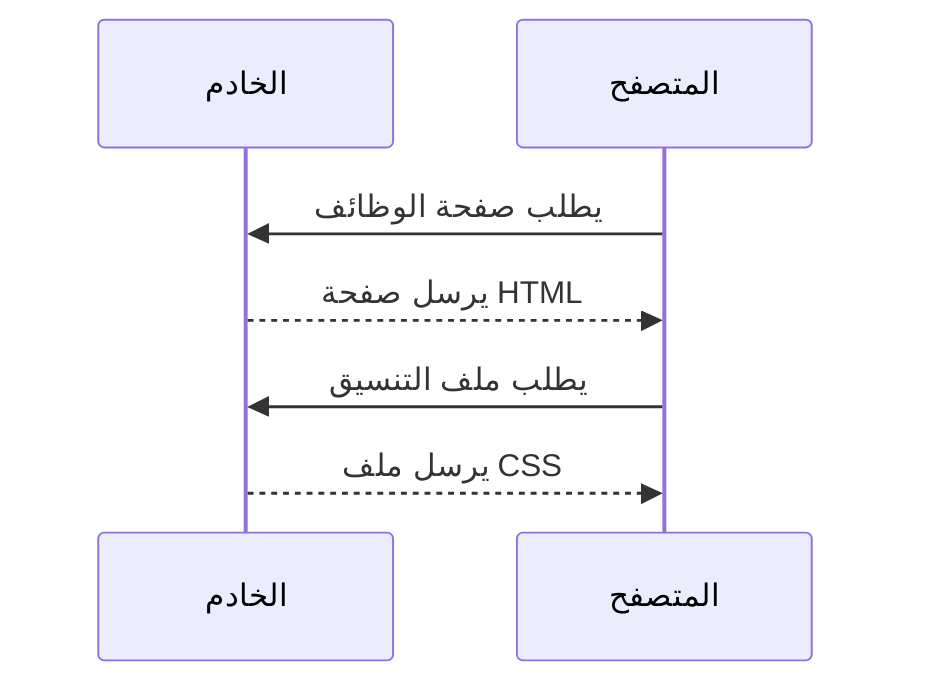

import { Aside, Steps } from '@astrojs/starlight/components';
import { Exercise, Hint, Solution, Quiz, Summary, Term } from '~/components/study';

كل صفحة تفتحها حوار قصير بين برنامجين: **المتصفح** يطلب، و**الخادم** يرد. Django يعمل في جهة الخادم، فكل ما ستكتبه في هذا المسار هو في النهاية طريقة لتجهيز الرد على طلب. لذلك نبدأ بفهم هذا الحوار.

## رحلة الرابط

لنفترض أنك كتبت هذا الرابط في المتصفح:

```text
https://jobs.example.com/jobs/?city=khartoum
```

كل جزء منه له معنى:

| الجزء | القيمة | معناه |
| --- | --- | --- |
| البروتوكول | `https` | طريقة الاتصال، وحرف `s` يعني أن الاتصال مشفّر |
| النطاق | `jobs.example.com` | اسم الخادم الذي نريده |
| المسار | `/jobs/` | الصفحة المطلوبة داخل الموقع |
| نص الاستعلام | `?city=khartoum` | بيانات إضافية مع الطلب، هنا اسم المدينة |

وهذا ما يحدث بعد أن تضغط Enter:

<Steps>

1. المتصفح يسأل <Term def="نظام يحوّل أسماء النطاقات مثل jobs.example.com إلى عنوان IP رقمي يفهمه الجهاز">DNS</Term> عن عنوان الخادم.

2. يتصل بالخادم على هذا العنوان، ويتفقان على تشفير الاتصال.

3. يرسل **طلب HTTP** يقول فيه ماذا يريد بالضبط.

4. الخادم يجهّز **الرد**. هنا يعمل Django.

5. المتصفح يقرأ صفحة HTML، ثم يطلب كل ملف تحتاجه (التنسيق، الصور، JavaScript) بطلب منفصل لكل ملف، ثم يعرض الصفحة.

</Steps>



## شكل الطلب

<Term def="بروتوكول نقل النصوص التشعبية: اللغة التي يتفاهم بها المتصفح والخادم">HTTP</Term> رسائل نصية لها شكل ثابت. هذا تقريباً ما يرسله المتصفح:

```http
GET /jobs/?city=khartoum HTTP/1.1
Host: jobs.example.com
Accept: text/html
Accept-Language: ar
Cookie: sessionid=8f3k2x
```

- **السطر الأول:** الطريقة `GET`، ثم المسار، ثم إصدار البروتوكول.
- **الترويسات (headers):** معلومات إضافية، كل سطر اسم وقيمة. مثلاً `Accept-Language` تخبر الخادم أنك تفضّل العربية.
- **الجسم (body):** فارغ هنا. عند إرسال نموذج بطريقة `POST` تأتي بياناته في الجسم.

<Aside type="note">
	المتصفحات الحديثة تستخدم HTTP/2 أو HTTP/3 لنقل نفس الرسائل بشكل أسرع وبصيغة مختلفة، لكن الأجزاء نفسها لم تتغير: طريقة، ومسار، وترويسات، وجسم.
</Aside>

## شكل الرد

```http
HTTP/1.1 200 OK
Content-Type: text/html; charset=utf-8

<!doctype html>
<html lang="ar" dir="rtl">
  <h1>الوظائف المتاحة في الخرطوم</h1>
  ...
</html>
```

السطر الأول فيه **رمز الحالة** `200`، ثم الترويسات، ثم سطر فارغ، ثم الجسم: صفحة HTML نفسها. الترويسة `Content-Type` تخبر المتصفح بنوع المحتوى ليعرف كيف يعرضه.

## الطرق: GET وPOST

الطريقة تقول للخادم ماذا تريد أن تفعل:

| الطريقة | تُستخدم لـ | مثال من منصة الوظائف |
| --- | --- | --- |
| `GET` | قراءة شيء دون تغييره | عرض الوظائف، البحث عن وظيفة |
| `POST` | إرسال بيانات تغيّر شيئاً | التقديم على وظيفة، تسجيل الدخول |

القاعدة التي تذكرها وثائق Django: أي طلب قد يغيّر حالة النظام، مثل التعديل في قاعدة البيانات، يجب أن يكون `POST`. و`GET` للطلبات التي لا تغيّر شيئاً، لذلك يناسب البحث: رابطه يمكن حفظه ومشاركته.

<Aside type="caution" title="لا تستخدم GET لكلمات المرور">
	بيانات `GET` تظهر في الرابط نفسه، فتُحفظ في سجل المتصفح وسجلات الخادم كنص واضح. نموذج الدخول دائماً `POST`.
</Aside>

ستقابل لاحقاً طرقاً أخرى مثل `PUT` و`PATCH` و`DELETE`، وأغلب استخدامها في بناء الـ API في المرحلة 4. نماذج HTML العادية لا تستخدم إلا `GET` و`POST`.

## رموز الحالة

الرقم الأول من الرمز يخبرك بنوع النتيجة: `2` نجاح، `3` تحويل لمكان آخر، `4` خطأ من جهة الطلب، `5` خطأ في الخادم.

| الرمز | الاسم | متى تراه في منصة الوظائف |
| --- | --- | --- |
| `200` | OK | فتحت قائمة الوظائف بنجاح |
| `302` | Found | حاولت التقديم دون تسجيل دخول، فحوّلك الموقع لصفحة الدخول |
| `403` | Forbidden | باحث عن عمل يحاول تعديل وظيفة نشرتها شركة |
| `404` | Not Found | فتحت رابط وظيفة حُذفت |
| `500` | Internal Server Error | خطأ في كود الـ view نفسه |

## HTTP بلا ذاكرة: لماذا نحتاج الـ cookies

HTTP <Term def="كل طلب مستقل تماماً، والخادم لا يتذكر شيئاً عن الطلبات السابقة">بلا حالة</Term>: كل طلب يصل للخادم كأنه أول مرة يراك. فكيف يعرف الموقع أنك سجّلت دخولك؟

بالـ cookie. عندما تسجّل دخولك، يرسل الخادم في الرد ترويسة `Set-Cookie`، والمتصفح يحفظها ويرسلها مع كل طلب بعدها. هذا شكلهما مختصراً، فالترويسة الحقيقية فيها أيضاً تاريخ انتهاء:

```http
Set-Cookie: sessionid=8f3k2x; HttpOnly; Path=/; SameSite=Lax
```

```http
Cookie: sessionid=8f3k2x
```

هذه هي طريقة Django: اسم الـ cookie الافتراضي عنده `sessionid`، وقيمتها مفتاح يربط طلبك ببيانات جلستك المحفوظة في الخادم. ستبني هذا بنفسك في درس الـ Sessions في المرحلة 2.

## أين يقع Django؟

Django يستقبل الطلب ويحوّله إلى كائن Python اسمه `HttpRequest`، فيه كل ما رأيته في هذا الدرس. وظيفتك أن ترجع كائن `HttpResponse`:

```python title="jobs/views.py"
from django.http import HttpResponse


def job_list(request):
    print(request.method)  # GET
    print(request.path)  # /jobs/
    print(request.GET.get("city"))  # khartoum
    print(request.headers["Accept-Language"])  # ar
    return HttpResponse("<h1>الوظائف المتاحة</h1>")
```

لا تحاول تشغيل هذا الكود الآن، فسنبني أول view في المرحلة 1. المهم أن ترى أن كل جزء من طلب HTTP له مكان واضح في Django: `request.GET` لنص الاستعلام، و`request.POST` لبيانات النموذج، و`request.COOKIES` للـ cookies.

## تدرّب

<Exercise title="تمرين: شغّل خادماً بنفسك">
	Python فيها خادم ويب بسيط جاهز. سترى به الطلبات والردود بعينك:

	<Steps>

	1. أنشئ مجلداً جديداً، وضع فيه ملفاً اسمه `index.html` فيه سطر واحد: `<h1>مرحباً</h1>`.

	2. افتح الطرفية داخل المجلد، وشغّل الخادم:

		```bash
		python -m http.server 8000
		```

	3. افتح في المتصفح `http://localhost:8000/`، ثم `http://localhost:8000/missing`.

	4. ارجع للطرفية واقرأ السطور التي ظهرت.

	</Steps>

	لكل طلب: ما الطريقة؟ ما المسار؟ ما رمز الحالة؟ وهل ترى طلباً لم تطلبه أنت؟

	<Hint>
		كل سطر في سجل الخادم ينتهي برمز الحالة. ابحث عن الطلبات التي يرسلها المتصفح تلقائياً، مثل أيقونة الموقع.
	</Hint>

	<Solution>
		ستظهر سطور مثل هذه (العنوان في أولها قد يكون `127.0.0.1` أو `::1`):

		```text
		::1 - - [30/Oct/2026 07:44:32] "GET / HTTP/1.1" 200 -
		::1 - - [30/Oct/2026 07:44:32] code 404, message File not found
		::1 - - [30/Oct/2026 07:44:32] "GET /missing HTTP/1.1" 404 -
		```

		الطلب الأول `GET` للمسار `/` ونجح برمز `200`. الثاني `GET` للمسار `/missing`، والملف غير موجود فرجع `404`. وغالباً سترى أيضاً طلباً لـ `/favicon.ico` لم تكتبه أنت: المتصفح يطلب أيقونة الموقع تلقائياً.

		أوقف الخادم بـ <kbd>Ctrl+C</kbd>.
	</Solution>
</Exercise>

<Aside type="tip" title="جرّب أدوات المطوّر">
	في أي موقع، اضغط <kbd>F12</kbd> وافتح تبويب Network، ثم أعد تحميل الصفحة. سترى كل طلب أرسله المتصفح، ولكل طلب طريقته ورمز حالته وترويساته.
</Aside>

<Quiz answer={2}>
الباحث عن عمل يضغط زر «قدّم الآن»، فيُحفظ طلب التقديم في قاعدة البيانات. أي طريقة يجب أن يستخدم النموذج؟

- `GET`
- `POST`
- لا يهم، كلاهما يعمل

التقديم يغيّر حالة النظام لأنه يضيف صفاً في قاعدة البيانات، لذلك يجب أن يكون `POST`.
</Quiz>

<Quiz answer={3}>
شركة حذفت وظيفة، ثم فتح باحث رابطها القديم. أي رمز حالة يتوقعه؟

- `200`
- `302`
- `404`
- `500`

الصفحة المطلوبة لم تعد موجودة، فالرد `404 Not Found`. أما `500` فيعني أن الخطأ في كود الخادم نفسه، لا في الطلب.
</Quiz>

<Summary>
	- المتصفح يرسل **طلباً**، والخادم يرجع **رداً**. Django يعمل في جهة الخادم.
	- الطلب فيه طريقة ومسار وترويسات وجسم. والرد فيه رمز حالة وترويسات وجسم.
	- `GET` للقراءة، و`POST` لأي شيء يغيّر البيانات أو يحمل كلمة مرور.
	- رموز الحالة: `2xx` نجاح، `3xx` تحويل، `4xx` خطأ في الطلب، `5xx` خطأ في الخادم.
	- HTTP بلا ذاكرة، والـ cookies هي ما يجعل الموقع يتذكرك.
	- في Django يصلك الطلب كـ `HttpRequest`، وترجع `HttpResponse`.
</Summary>
